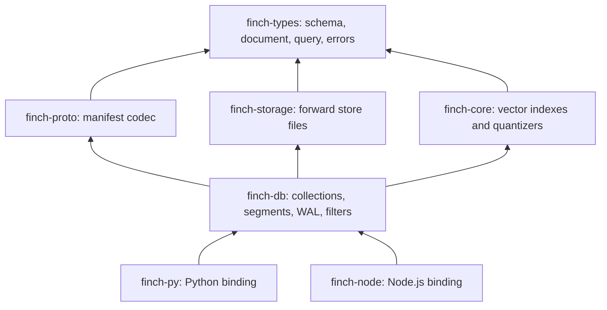
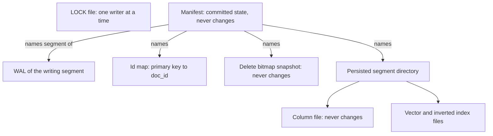
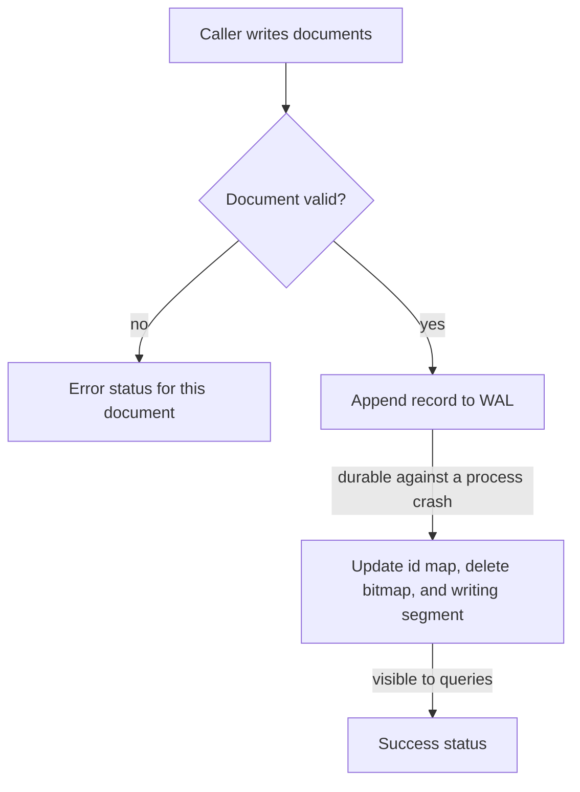
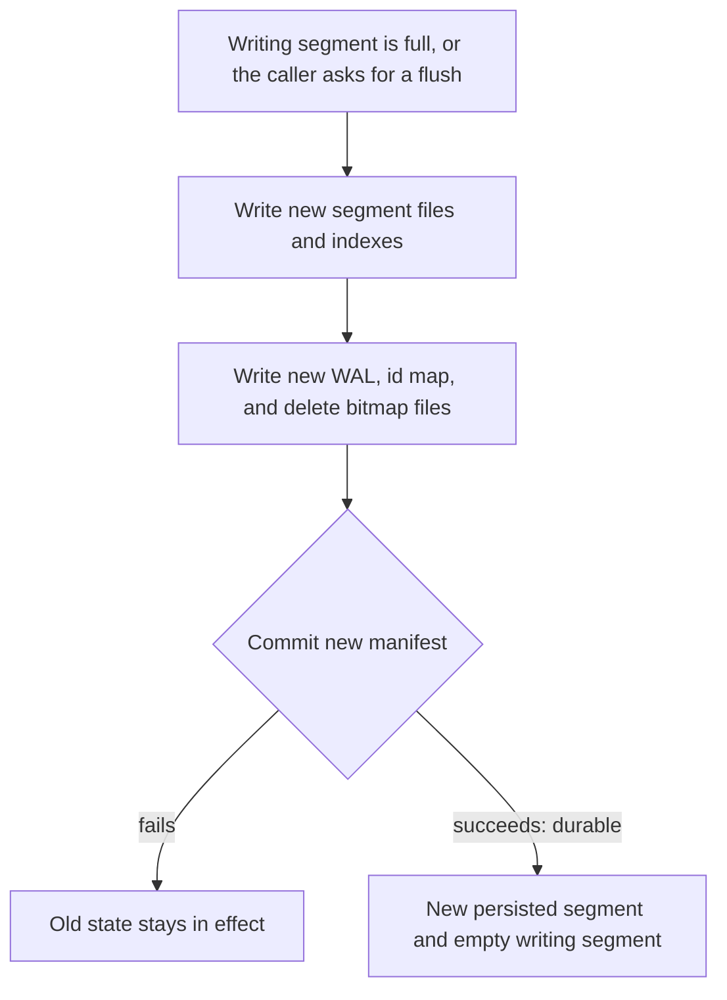
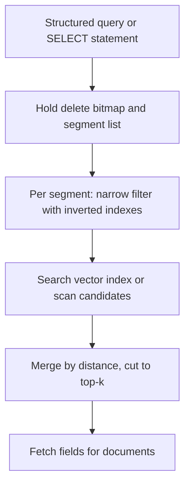
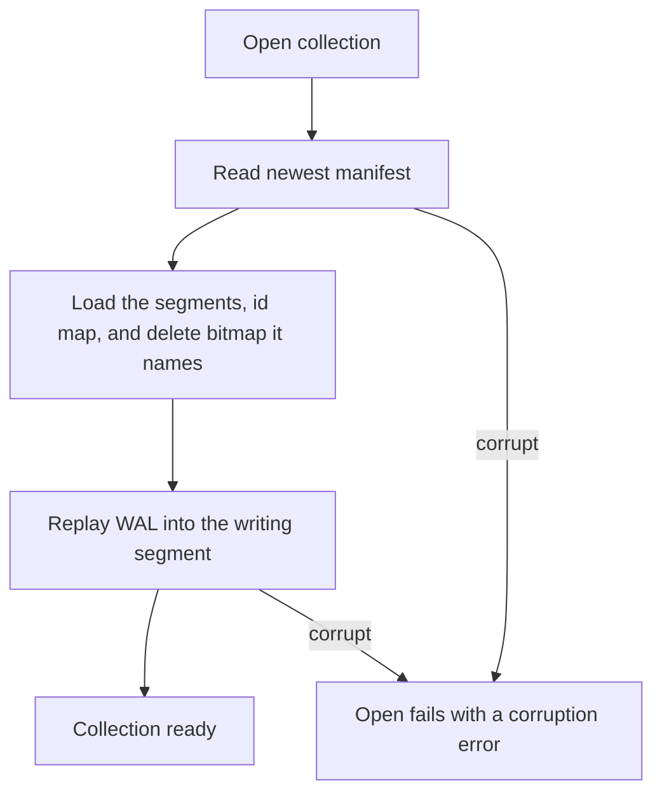
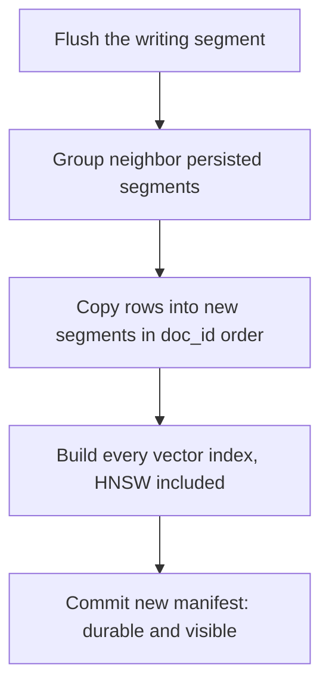

# finch-db Architecture

## 1. What finch-db is

finch-db is a vector database that runs inside your process. There is no server. A collection
is one directory on disk. It holds documents, and each document has a primary key, scalar
fields, and dense or sparse vector fields. A collection answers vector queries, SQL-like
filters, and `SELECT` statements.

An arrow points from a crate to a crate it depends on.

## 2. A collection on disk

The manifest is the committed state of a collection. It names the schema, the persisted
segments, the writing segment, the id map, and the delete bitmap. Open ignores every file that
the manifest does not name.

Every document gets a `doc_id`, an internal number. Each insert, upsert, or update gives the
document a new `doc_id`. The id map points each primary key at its current `doc_id`. The delete
bitmap is the set of `doc_id`s that a delete or a replacement retired. Each flush writes the id
map to a sorted checkpoint file that the manifest names. A read-write open rebuilds its working
copy of the id map from that file and the WAL; a read-only open reads the file directly.

A segment is a group of documents. The writing segment holds new documents in memory, and the
WAL (write-ahead log) records each change to it. A flush turns the writing segment into a
persisted segment. After finch-db writes a manifest, a delete bitmap snapshot, an id map checkpoint,
or the column file or inverted index file of a segment, it never changes that file. A newer file
replaces it.

## 3. The write path

finch-db appends each write to the WAL before it changes any state. From that point, a process
crash cannot lose the write, because open replays the WAL. Then finch-db points the primary key at
the new `doc_id`, retires the old one, and adds the document to the writing segment.

## 4. Flush

A flush writes every new file, then commits a new manifest. The flush becomes durable only at
that commit. Queries see the flushed documents the whole time, first in the writing segment and
then in the new persisted segment.

## 5. The read path

A query holds the delete bitmap and the segment list until its scan ends. A concurrent flush or
upsert therefore cannot hide a document from it. Each segment uses its inverted indexes to find
candidate documents, then searches its vector index or computes exact distances for a small set.
finch-db merges the results of all segments by distance, skips deleted documents, and fetches the
requested fields.

## 6. Crash recovery

Open reads the newest manifest and loads the files it names. Then it replays the WAL, which
restores every write since the last flush. A crash can tear only the last WAL record, and replay
stops quietly at it. Any other damage to the WAL or the manifest makes open fail.

## 7. Compaction

Compaction merges persisted segments into new ones and builds every missing vector index. Rows
keep their `doc_id`s. When deleted rows make up more than 30 percent of the persisted rows,
compaction drops them. Otherwise the delete bitmap keeps hiding them.

## 8. Guarantees

- Open sees the old manifest or the new one, never a mix.
- A flush, a compaction, a column change, and an index change each take effect at one manifest
  commit.
- A query sees an upsert or an update as one step: the old version or the new one, never both.
- Each document in a batch write succeeds or fails alone.
- A process crash does not lose an acknowledged write.
- By default, an operating system crash or power loss can lose recent writes. The global
  setting `wal_fsync_every_docs` makes finch-db fsync the WAL every N records; its default, 0,
  never fsyncs.
- A delete is in the WAL before it returns and commits a new manifest. If that commit fails,
  the delete still stands, and the next delete or flush retries the commit.
- A filter matches the same documents with or without an inverted index.
- A filter condition on a missing field does not match.
- One process at a time can open a collection for writing.

## Where to look

| Concept | Path |
|---|---|
| Workspace crates | `Cargo.toml` |
| Public collection API | `crates/finch-db/src/collection.rs` |
| Write, flush, query, open, compaction | `crates/finch-db/src/collection` |
| On-disk file names and the lock | `crates/finch-db/src/collection_files.rs` |
| Manifest | `crates/finch-db/src/version.rs` |
| WAL | `crates/finch-db/src/wal.rs` |
| Filter evaluation | `crates/finch-db/src/sqlengine` |
| Vector index algorithms | `crates/finch-core/src/algorithm` |
| Global config, including WAL fsync | `docs/global-config.md` |
